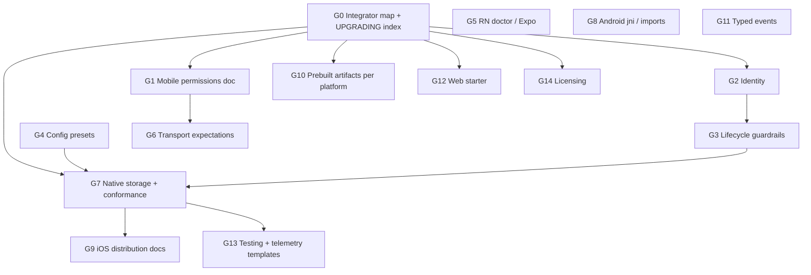

# SDK — integrator friction inventory and PR roadmap

**Purpose:** A shared plan for reducing integration time and support load without changing wire protocol behavior or breaking existing features. Intended for engineering review: pick workstreams, assign PRs, and stack related fixes.

**Audience:** SDK maintainers and integrators (internal review).

**Scope:** React Native, native iOS/Android, Flutter, Python, Web, C/C#/Java/Ruby, documentation, packaging, and developer ergonomics. Security defaults (fail-closed encryption) stay unless explicitly called out as a *dev-only* preset.

**How this was produced:** Repo review of bridge contracts (`docs/bridges/`), integration guides, binding READMEs, `UPGRADING.md`, and the React Native example app (November 2026).

---

## Executive summary

Integrators hit friction in four buckets:

1. **Navigation** — too many doc entry points; no single “time to first message” map.
2. **Parity** — React Native auto-initializes MLS and storage; native iOS/Android require two storage providers and a long toolchain path.
3. **Platform setup** — permissions, background modes, grant timing, and Android API level edge cases are easy to get wrong.
4. **Configuration & identity** — large `ProtocolConfig` surfaces, `profile` vs `off1…` address confusion, and strict lifecycle ordering that can drop events silently.

This document lists **31 friction themes**, groups them into **14 relation groups (G0–G14)** for PR planning, and defines **parallel workstreams** so unrelated changes do not collide in the same PR or release train.

**Suggested first deliverables for review:**

| Priority | Group | Deliverable |
|----------|-------|-------------|
| P0 | G0 | Integrator map + `UPGRADING.md` version index |
| P0 | G1 | Unified `docs/mobile-permissions.md` |
| P0 | G7 | Native storage reference kits (iOS + Android) + conformance runner docs |
| P1 | G5 | RN upgrade doctor + Expo callout |
| P1 | G4 PR1 | RN config presets (`forScenario`) |

---

## How to use this document

| Section | Use it to |
|---------|-----------|
| [Friction catalog](#friction-catalog-full-descriptions) | Understand *what* hurts and *how* to fix without protocol changes |
| [Category index](#categories-by-type) | Filter by documentation vs product vs packaging |
| [Relation groups G0–G14](#relation-groups-pr-planning-units) | Decide **one PR vs stacked PRs** |
| [Pick-up order](#recommended-pick-up-order) | Sequence work for the team |
| [Parallel streams](#parallel-workstreams) | Assign owners without CI/repo clashes |
| [Do-not-mix rules](#do-not-mix-rules) | Avoid bindgen/bridge/release conflicts |
| [Review status](#review-status) | Senior sign-off and tracking |

**Relation groups:** Items in the same group should usually ship together or as an ordered stack (PR1 → PR2). Items in different groups can run in parallel if [do-not-mix rules](#do-not-mix-rules) are respected.

---

## Friction catalog (full descriptions)

Each item is a **theme**, not necessarily a single ticket. Overlaps are called out in [relation groups](#relation-groups-pr-planning-units).

### Cross-cutting

#### #1 Documentation sprawl / no single start

- **Problem:** Contracts live in `docs/bridges/`; tutorials in `docs/*-integration.md`; the RN README is very long; `UPGRADING.md` is a full migration encyclopedia. No one-page “time to first message” indexed by platform.
- **Impact:** Hours reading the wrong layer (contract vs tutorial).
- **Fix (non-breaking):** `docs/integrator-map.md` with links, estimated setup time, minimal sample per platform.
- **Expected:** New devs reach send/receive quickly with a known path.

#### #2 `ProtocolConfig` ceremony at FFI boundary

- **Problem:** Native Swift/Kotlin/Java/C examples require many explicit fields (~16 required + options). Rust has a builder; generated bindings lack ergonomic defaults.
- **Impact:** Copy-paste setup, misconfiguration, long first integration.
- **Fix:** Host-side helpers (`meshDefaults`, builders, presets) wrapping existing UDL defaults — no wire change.
- **Expected:** Few-line first `OfflineProtocol` on every native binding.

#### #3 Identity: `profile` vs `off1…` address vs `recipient`

- **Problem:** `profile` is local namespace; peers only know derived `off1…` addresses. Examples still use `"bob"` / `"user456"` as recipients.
- **Impact:** “Mesh broken” when addressing is wrong (especially post–v0.21).
- **Fix:** Doc sweep; optional dev warning when recipient is not address-shaped; identity cheat sheet.
- **Expected:** Wrong-address mistakes obvious at dev time.

#### #4 Strict lifecycle ordering (silent data loss)

- **Problem:** Event callback before `start()`, MLS/storage before send, interest/replication in a specific window — violations can drop startup events without loud errors.
- **Impact:** Intermittent “missed first message” bugs.
- **Fix:** Debug/runtime ordering checks with clear errors; one lifecycle diagram in integrator map.
- **Expected:** Ordering mistakes fail fast.

#### #5 Events as opaque JSON (weak native typing)

- **Problem:** Events cross as JSON strings by design; native hand-parses `type`; TypeScript types maintained separately (bridge contract C3).
- **Impact:** Runtime-only event bugs; no IDE autocomplete on native.
- **Fix (optional):** Generated or hand-written typed facades per language; keep raw JSON path.
- **Expected:** Typed events without losing flexibility.

#### #6 `UPGRADING.md` intimidation

- **Problem:** One file spans v0.16 → current with many version-tagged sections.
- **Impact:** Delayed upgrades; skipped mandatory steps.
- **Fix:** Version picker at top (“on X → going to Y → read sections …”); per-surface checklists.
- **Expected:** Upgrade planning in ~15 minutes.

---

### React Native / TypeScript

#### #7 Permissions and plist/manifest fragmentation

- **Problem:** Minimal RN README vs richer example app (Local Network, Bonjour, location). Android Wi‑Fi/LAN needs grant timing before `start()` and API 37 `ACCESS_LOCAL_NETWORK` (app must declare; SDK intentionally does not).
- **Impact:** Peers not found on LAN/Wi‑Fi while BLE works.
- **Fix:** Unified mobile permissions guide; optional `requestMeshPermissions()` helper.
- **Expected:** One checklist per transport mix.

#### #8 Configuration surface (DORS, relay, encryption)

- **Problem:** Tuning spread across README, `configuration.md`, `dors-configuration.md`; defaults differ slightly between docs.
- **Impact:** Over/under-tuning; long stabilization phase.
- **Fix:** TS presets (`forScenario`); align default tables in docs.
- **Expected:** Production-ready config without five documents.

#### #9 Wi‑Fi Direct time expectations

- **Problem:** Documented ~1–2+ minutes for auto-accept group formation; often treated as a hang.
- **Impact:** False “SDK broken” during QA.
- **Fix:** Prominent quick-start note; optional diagnostic/progress signal.
- **Expected:** Visible progress instead of blind retries.

#### #10 Expo Go unsupported

- **Problem:** Easy to attempt integration on Expo Go until native module failure.
- **Impact:** Dead end for beginners.
- **Fix:** Requirements callout at install; clear error in unsupported hosts.
- **Expected:** Wrong stack choice surfaced immediately.

#### #11 Legacy iOS Podfile / linker (pre–0.20)

- **Problem:** Manual `pod 'MeshSdk'` and custom linker flags still common in older apps.
- **Impact:** `pod install` / simulator link failures.
- **Fix:** Doctor script scanning Podfile/Gradle; troubleshooting in integrator map.
- **Expected:** Mechanical upgrades.

---

### Native iOS

#### #12 Two integration paths, very different effort

- **Problem:** RN: `npm install` + pods. Native: Rust targets, mobile profile, XCFramework, SwiftPM from shared bridge tree; `swift build` on Mac is not the real package path.
- **Impact:** Native iOS often days vs RN minutes.
- **Fix:** One blessed consumer path (release SwiftPM tarball + Xcode); de-emphasize hand steps.
- **Expected:** Native path closer to “add dependency, storage, start.”

#### #13 MLS + dual storage providers (no RN auto-init)

- **Problem:** Native must implement `MlsStorageProvider` + `ProtocolStateStorageProvider` (Keychain + app container, fsync, 8 MiB cap, uninstall cleanup). RN hides this.
- **Impact:** Largest native iOS friction; fail-closed until `initializeMls`.
- **Fix:** Shipped reference module (e.g. `OfflineProtocolStorageKit`) from RN bridge patterns.
- **Expected:** Encrypted mesh without reimplementing Keychain rules.

#### #14 Background modes and BLE reliability

- **Problem:** Missing `UIBackgroundModes` → throttled BLE, false `peer_lost`.
- **Impact:** Intermittent background mesh.
- **Fix:** Debug assertion when BLE enabled but modes missing; link from integrator map.
- **Expected:** Plist mistakes caught in dev builds.

---

### Native Android

#### #15 JNI library naming (manual integration)

- **Problem:** Cargo emits `liboffline_protocol_uniffi.so`; loader expects `libuniffi_offline_protocol.so`.
- **Impact:** Obscure load failures on first native integration.
- **Fix:** Prominent guide note; Gradle/AAR validation in consumer template.
- **Expected:** Zero rename mistakes.

#### #16 Package/import confusion

- **Problem:** RN wrapper `com.offlineprotocol.`* vs engine `uniffi.offline_protocol`.
- **Impact:** Wrong API surface / compile errors.
- **Fix:** Canonical consumer-check sample imports.
- **Expected:** One obvious import story.

#### #17 Same MLS/storage gap as iOS

- **Problem:** Identical to #13 on Android (Keystore + app storage); RN auto-inits.
- **Fix:** Published storage module aligned to conformance tests.
- **Expected:** Parity with RN `start()` for encryption.

#### #18 Foreground service / background mesh

- **Problem:** Reliable Android BLE with screen off often depends on RN foreground service patterns; native/Flutter must wire similar lifecycle.
- **Impact:** “Works in foreground only” without reading bridge docs.
- **Fix:** Minimum Android lifecycle recipe; optional headless wake documentation for native AAR.
- **Expected:** Predictable background behavior from docs.

---

### Flutter

#### #19 Not on pub.dev; Rust build prerequisite

- **Problem:** Path dependency; `generate-bindings.sh` + `build:uniffi:all`; iOS `sync_bridge_rn.sh` after bridge changes.
- **Impact:** Contributor-grade, not app-team-grade.
- **Fix:** pub.dev with prebuilt jniLibs/XCFramework in plugin (release/CI).
- **Expected:** `flutter pub add` without Rust toolchain.

#### #20 Permissions docs live under React Native

- **Problem:** Flutter README points at RN permission sections.
- **Impact:** Context switching between ecosystems.
- **Fix:** Shared `docs/mobile-permissions.md` (see G1).
- **Expected:** One permission story for all mobile bindings.

---

### Python

#### #21 Wheel coverage gaps

- **Problem:** No Intel macOS, musl/Alpine, older glibc; no sdist.
- **Impact:** CI/deploy failures on common variants.
- **Fix:** Expand wheels where feasible; Docker one-liner + honest unsupported matrix.
- **Expected:** `pip install` or immediate fallback path.

#### #22 Mandatory `state_root` and install-owned data

- **Problem:** `ProtocolManager` requires explicit `state_root`; uninstall must remove it.
- **Impact:** Ops mistakes, leaked data.
- **Fix:** Sensible default paths with override; uninstall hook in service template.
- **Expected:** Less boilerplate for gateways/scripts.

---

### C / C# / Java

#### #23 Build Rust first + env wiring

- **Problem:** C# `OFFLINE_PROTOCOL_LIBRARY_DIR`; Java JDK 22+ and native access flags; C hand-built JSON config.
- **Impact:** Desktop integration feels like internal tooling.
- **Fix:** Package managers with prebuilt natives; config helpers.
- **Expected:** Desktop quick start comparable to Python wheels.

#### #24 Java positional `ProtocolConfig`

- **Problem:** Long positional constructor; one wrong boolean flips transports.
- **Impact:** Subtle misconfiguration.
- **Fix:** Builder or named factories (see G4).
- **Expected:** Harder to accidentally disable BLE/internet.

---

### Web

#### #25 Experimental worker-only architecture

- **Problem:** Dedicated worker, OPFS, page carriers (WebRTC/BLE), strict ordering — high conceptual load.
- **Impact:** Weeks for teams expecting npm drop-in.
- **Fix:** Opinionated Vite starter; clear experimental boundaries in integrator map.
- **Expected:** Cloneable reference app and go/no-go clarity.

---

### Storage, security, testing, licensing

#### #26 Storage conformance hidden gate

- **Problem:** Custom adapters must pass conformance suites; `Ok`-always adapters can still be wrong (C11).
- **Impact:** Data loss risk in production.
- **Fix:** Published `runStorageConformance` per language with pass/fail report.
- **Expected:** Custom storage is a supported, verifiable path.

#### #27 Fail-closed encryption default

- **Problem:** `requireEncryption` default true; sends fail until MLS init (correct security; surprises prototyping).
- **Impact:** “Nothing sends” during early dev.
- **Fix:** Documented dev-only preset; debug log on first `EncryptFailed` with remediation.
- **Expected:** Security default unchanged; explicit prototyping path.

#### #28 Physical devices required

- **Problem:** BLE/Wi‑Fi Direct not faithfully simulated.
- **Impact:** Simulator-only false confidence.
- **Fix:** Integration test matrix; promote `offline-protocol-verify` and example app as golden path.
- **Expected:** Standard QA checklist.

#### #29 Multiple SDK apps on one phone

- **Problem:** Same BT service; disambiguation via `appId`; older SDK versions mis-pair.
- **Impact:** Confusing neighbor lists in dogfood.
- **Fix:** Diagnostics doc; optional log when multiple local apps share service.
- **Expected:** Fewer wrong-peer reports in test fleets.

#### #30 Telemetry session lifecycle (C12)

- **Problem:** Bindings should open/close telemetry session on foreground/background; easy to skip on custom native hosts.
- **Impact:** Skewed analytics, not mesh breakage.
- **Fix:** Defaults in RN/Flutter; lifecycle stubs in consumer-check apps.
- **Expected:** Telemetry works out of the box on mobile.

#### #31 Dual license (AGPL vs commercial)

- **Problem:** AGPL on npm/PyPI metadata; commercial path in separate doc.
- **Impact:** Legal review delay before first import.
- **Fix:** One-page license decision tree linked from package READMEs.
- **Expected:** Faster legal sign-off.

---

## Categories by type

| Category | Item numbers |
|----------|----------------|
| **Documentation & navigation** | 1, 6, 7, 8, 9, 20, 28, 31 |
| **API / config ergonomics** | 2, 3, 8, 24, 27 |
| **Lifecycle & platform behavior** | 4, 9, 14, 18, 29 |
| **Native vs RN parity** | 12, 13, 17, 26, 27 |
| **Packaging & distribution** | 12, 15, 19, 21, 23 |
| **React Native specific** | 7, 10, 11 |
| **Web specific** | 25 |
| **Testing & ops** | 28, 30 |
| **Licensing** | 31 |

**Merged epic count (if clubbing duplicates):** ~12–15 epics across the above.

---

## Relation groups (PR planning units)

### G0 — Integrator navigation

| Field | Value |
|-------|--------|
| **Items** | #1, #6 |
| **Relation** | Same doc surface; UPGRADING index links from integrator map |
| **PR shape** | **1 PR** — `docs/integrator-map.md` + UPGRADING version picker |
| **Stream** | `docs-platform` |
| **Depends on** | Nothing |
| **Blocks (soft)** | All groups should link to G0 when their docs land |

---

### G1 — Unified mobile permissions & background setup

| Field | Value |
|-------|--------|
| **Items** | #7, #14, #20; document #18 in same guide |
| **Relation** | Single permissions/background narrative for iOS, Android, Flutter |
| **PR shape** | **PR1:** `docs/mobile-permissions.md` + cross-links. **PR2 (optional):** RN `requestMeshPermissions()` |
| **Stream** | `docs-platform` → optional `react-native` |
| **Stack after G0** | Link from integrator map |
| **Do not mix** | G7 native storage code; G11 UDL/bindgen |

---

### G2 — Identity & addressing

| Field | Value |
|-------|--------|
| **Items** | #3 |
| **Relation** | Doc sweep + optional validation layer |
| **PR shape** | **PR1:** examples + identity one-pager. **PR2:** address-shape dev warning (RN/TS first) |
| **Stream** | `docs-platform` → `react-native` |
| **Pairs with** | G4 lifecycle errors can mention `localAddress()` |

---

### G3 — Lifecycle ordering guardrails

| Field | Value |
|-------|--------|
| **Items** | #4 |
| **Relation** | Same guardrail theme across surfaces |
| **PR shape** | **PR1:** RN/TS checks. **PR2:** Native Swift/Kotlin (shared bridge — one coordinated mobile PR if shared helpers) |
| **Stream** | `react-native-bridge` (ADR 0025 shared sources) |
| **Pairs with** | G7 native quickstart docs |
| **Do not mix** | G11 UDL changes in same PR |

---

### G4 — Config ergonomics & presets

| Field | Value |
|-------|--------|
| **Items** | #2, #8, #24; RN presets cover #8 |
| **Relation** | Same goal: reduce `ProtocolConfig` footguns |
| **PR shape** | **PR1:** RN/TS `forScenario` + doc tables. **PR2–5:** Swift, Kotlin, Java, C#/C helpers (parallel by owner) |
| **Stream** | Per-binding |
| **Do not mix** | UDL edits; wrap existing fields only |

---

### G5 — RN upgrade & host compatibility

| Field | Value |
|-------|--------|
| **Items** | #10, #11 |
| **Relation** | Wrong host + legacy iOS integration leftovers |
| **PR shape** | **1 PR** — Expo callout + doctor script/docs |
| **Stream** | `react-native-tooling` |

---

### G6 — Transport expectations

| Field | Value |
|-------|--------|
| **Items** | #9, #29 |
| **Relation** | Reduce false “broken SDK” reports; docs first, product optional |
| **PR shape** | **PR1:** docs/troubleshooting. **PR2:** diagnostics (optional, separate) |
| **Stream** | `docs-platform` → optional `react-native-bridge` |

---

### G7 — Native MLS path parity (storage)

| Field | Value |
|-------|--------|
| **Items** | #13, #17, #26, #27 |
| **Relation** | **Tight cluster:** reference storage iOS+Android; conformance runner; dev encryption preset (doc or G4) |
| **PR shape** | **PR1:** Storage kits + consumer-check wiring. **PR2:** conformance runner exposure. **PR3:** dev preset doc/helper |
| **Stream** | `native-packages` |
| **Depends on (docs)** | G0, G3 |
| **Do not mix** | G11 bindgen; unrelated bridge refactors; G10 artifact layout in same release without coordination |
| **CI note** | Shared `bindings/react-native/{ios,android}` — Flutter, SwiftPM, Android Library jobs |

---

### G8 — Android native footguns

| Field | Value |
|-------|--------|
| **Items** | #15, #16 |
| **Relation** | Manual/library integrator ergonomics |
| **PR shape** | **1 PR** — guide + jni name check + consumer-check imports |
| **Stream** | `android-native` |
| **Can parallel** | G7 if file paths do not overlap |

---

### G9 — Native iOS distribution path

| Field | Value |
|-------|--------|
| **Items** | #12 (docs); packaging overlaps G10 |
| **Relation** | Artifacts + narrative; pair with G7 in docs (“package + storage kit”) |
| **PR shape** | **PR1:** integrator map / iOS guide. **PR2:** release/CI packaging (release train) |
| **Stream** | `release-swift` + `docs-platform` |

---

### G10 — Prebuilt artifacts & package managers

| Field | Value |
|-------|--------|
| **Items** | #19, #21, #23 (+ distro aspects of #12) |
| **Relation** | One distribution epic, **split per platform** |
| **PR shape** | **1 PR per platform:** Flutter pub.dev, Python wheels, C#/Java packages |
| **Stream** | `release-ci` |
| **Do not mix** | G11, partial bindgen, G7 bridge refactors |

---

### G11 — Optional typed events

| Field | Value |
|-------|--------|
| **Items** | #5 |
| **Relation** | Standalone; per-language facades optional |
| **PR shape** | TS first; Swift/Kotlin facades as follow-ups |
| **Stream** | `events-typing` |
| **Do not mix** | UDL without full `./scripts/generate-bindings.sh` (C1) |

---

### G12 — Web quickstart

| Field | Value |
|-------|--------|
| **Items** | #25 |
| **Relation** | Isolated to `bindings/web` |
| **PR shape** | **1 PR** — Vite template + integrator map link |
| **Stream** | `web` |

---

### G13 — Testing & ops

| Field | Value |
|-------|--------|
| **Items** | #28, #30 |
| **Relation** | QA matrix + telemetry templates in consumer-checks |
| **PR shape** | **PR1:** testing matrix. **PR2:** consumer-check telemetry stubs (merge with G7 PR1 if same apps) |
| **Stream** | `docs-platform` + `consumer-check` |

---

### G14 — Licensing

| Field | Value |
|-------|--------|
| **Items** | #31 |
| **Relation** | Standalone |
| **PR shape** | **1 PR** — `docs/licensing-decision-tree.md` + README links |
| **Stream** | `docs-platform` |
| **Anytime after G0** | |

---

## Group dependency diagram

---

## Recommended pick-up order

| Order | Group | Rationale | Typical PRs |
|------:|-------|-----------|-------------|
| 1 | **G0** | Everything links here | 1 |
| 2 | **G1**, **G2 PR1** | Fast wins; no protocol change | 2 (parallel OK) |
| 3 | **G5**, **G14** | RN support load + legal clarity | 2 (parallel OK) |
| 4 | **G3 PR1** | Stops silent event loss on RN | 1 |
| 5 | **G4 PR1**, **G6 PR1** | Easier config + transport clarity | 1–2 |
| 6 | **G7 PR1** | Largest native vs RN gap | 1 (large) |
| 7 | **G8**, **G9** docs | Android/iOS native polish | 1–2 |
| 8 | **G3 PR2**, **G7 PR2** | Native lifecycle + conformance | 2 |
| 9 | **G4 PR2–5** | Per-language config helpers | up to 4 parallel |
| 10 | **G10** | pub.dev / wheels / NuGet — release cadence | 1 per platform |
| 11 | **G11**, **G12** | Optional; isolated | as needed |

**Suggested first three PRs for the team:**

1. **G0** — integrator map + UPGRADING index
2. **G1** — `mobile-permissions.md` + cross-links
3. **G7 PR1** *or* **G5** — product impact (storage kits) vs support load (doctor/Expo)

---

## Parallel workstreams

| Stream | Groups | Notes |
|--------|--------|--------|
| **A · Docs platform** | G0, G1, G2 PR1, G6 PR1, G13 PR1, G14, G9 PR1 | Low clash if separate files |
| **B · React Native** | G3 PR1, G4 PR1, G5, G6 PR2 | JS/TS + optional bridge |
| **C · Native mobile libs** | G7, G8, G3 PR2, G13 PR2 | Serialize bridge PRs |
| **D · Release / CI** | G10 | Isolate per platform |
| **E · Web** | G12 | Independent |
| **F · Events** | G11 | Treat like bindgen train if UDL touched |

---

## Do-not-mix rules

1. **UDL /** `./scripts/generate-bindings.sh` **/ partial bindgen (C1)** — dedicated PR only; all bindings regenerated together. Do not combine with unrelated bridge edits.
2. **Shared bridge trees** (`bindings/react-native/ios`, `bindings/react-native/android`, ADR 0025) — prefer **one bridge PR at a time** for G3, G6 PR2, G7. Flutter, Swift Package, and Android Library CI all consume these sources.
3. **G10 (artifacts)** vs **G7 (storage source)** — parallel OK unless both change jniLibs/XCFramework layout in the same release.
4. **G4 multi-language** — parallel per language; do not change UDL defaults in one binding only.
5. **G1 docs before G1 PR2** — permissions API follows unified doc to avoid drift.

---

## Item → group lookup

| # | Group | # | Group |
|---|--------|---|--------|
| 1 | G0 | 16 | G8 |
| 2 | G4 | 17 | G7 |
| 3 | G2 | 18 | G1 (doc) |
| 4 | G3 | 19 | G10 |
| 5 | G11 | 20 | G1 |
| 6 | G0 | 21 | G10 |
| 7 | G1 | 22 | (Python ops; fold into G10 doc or separate small doc PR) |
| 8 | G4 | 23 | G10 |
| 9 | G6 | 24 | G4 |
| 10 | G5 | 25 | G12 |
| 11 | G5 | 26 | G7 |
| 12 | G9, G10 | 27 | G7, G4 |
| 13 | G7 | 28 | G13 |
| 14 | G1 | 29 | G6 |
| 15 | G8 | 30 | G13 |
| 31 | G14 |

*Note: #22 is intentionally light in grouping — treat as **G10 follow-up** (Python defaults doc) or a small standalone doc PR.*

---

## Review status

*For senior review — fill in after discussion.*

| Group | Approved? | Owner | Target sprint | Notes |
|-------|-----------|-------|---------------|-------|
| G0 | | | | |
| G1 | | | | |
| G2 | | | | |
| G3 | | | | |
| G4 | | | | |
| G5 | | | | |
| G6 | | | | |
| G7 | | | | |
| G8 | | | | |
| G9 | | | | |
| G10 | | | | |
| G11 | | | | |
| G12 | | | | |
| G13 | | | | |
| G14 | | | | |

**Overall decision:** ☐ Proceed as phased roadmap  ☐ Reprioritize (notes below)  ☐ Defer items (list groups)

**Comments:**

---

## References

| Resource | Path |
|----------|------|
| Integrator map (G0) | [docs/integrator-map.md](integrator-map.md) |
| Bridge contracts | [docs/bridges/README.md](bridges/README.md) |
| Upgrading | [docs/UPGRADING.md](UPGRADING.md) |
| RN package README | [bindings/react-native/README.md](../bindings/react-native/README.md) |
| iOS integration | [docs/ios-integration.md](ios-integration.md) |
| Android integration | [docs/android-integration.md](android-integration.md) |
| React Native integration | [docs/react-native-integration.md](react-native-integration.md) |
| MLS integration | [docs/mls-integration.md](mls-integration.md) |
| Native packages ADR | [docs/adr/0025-native-packages-are-assembled-in-place.md](adr/0025-native-packages-are-assembled-in-place.md) |

---

*Document version: 1.0 — created for internal friction-reduction planning. Update group status and links as PRs land.*
