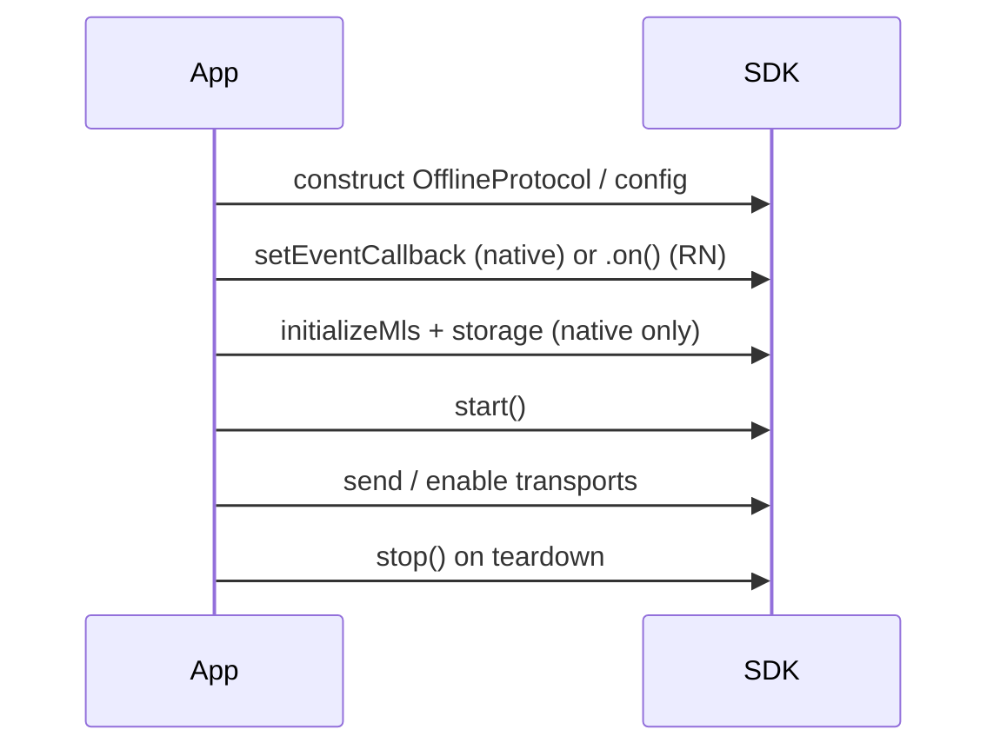

# Integrator map

One place to choose a platform, estimate setup time, and land on the right
guide. You do not need this file if you already know whether you are
integrating React Native, native mobile, desktop, or the browser.

**Changing behaviour in the SDK or a binding?** Read [bridge contracts](bridges/README.md)
and the relevant ADR, not this page. **Bumping the SDK version?** Use the
[Upgrading guide version index](UPGRADING.md#start-here-version-and-surface-index)
before reading all of [UPGRADING.md](UPGRADING.md).

---

## Pick your path

| I am building… | Start here | Typical first-session time | Notes |
|----------------|------------|----------------------------|-------|
| React Native / Expo (dev client) | [QUICKSTART](../QUICKSTART.md) → [RN package README](../bindings/react-native/README.md) | ~15–30 min to first `start()` | Expo Go is not supported (native module). |
| React Native (deep dive) | [react-native-integration.md](react-native-integration.md) | 1–2 h for transports + events | Package README is the API reference. |
| Native iOS (Swift) | [ios-integration.md](ios-integration.md) | 2 h–2 days | RN path is much faster; native needs storage providers + XCFramework or SwiftPM release. |
| Native Android (Kotlin) | [android-integration.md](android-integration.md) | 2 h–2 days | Same parity gap as iOS for MLS storage. |
| Flutter | [bindings/flutter/README.md](../bindings/flutter/README.md) | 1–4 h | Path dependency today; build UniFFI natives like React Native. |
| Python (desktop / gateway) | [bindings/python/README.md](../bindings/python/README.md) | ~30 min with wheels | `pip install offline-protocol-sdk`; set `state_root` explicitly. |
| Local API (multi-app on one host) | [local-api.md](local-api.md) | ~1 h | Service + policy file; clients over socket. |
| C / C++ / Go (via C) | [bindings/c/README.md](../bindings/c/README.md) | 1–2 h | Build or ship `liboffline_protocol_uniffi`; JSON config + callbacks. |
| C# / .NET 8 | [bindings/csharp/README.md](../bindings/csharp/README.md) | 1–2 h | `OFFLINE_PROTOCOL_LIBRARY_DIR` + engine thread rules. |
| Java (JVM 22+) | [bindings/java/README.md](../bindings/java/README.md) | 1–2 h | `--enable-native-access`; positional `ProtocolConfig`. |
| Ruby | [bindings/ruby/README.md](../bindings/ruby/README.md) | ~1 h | Keep engine alive while callbacks exist. |
| Web (browser) | [bridges/web.md](bridges/web.md) | days (experimental) | Worker + OPFS; not a drop-in npm widget. |

---

## Five-minute smoke test (React Native)

The fastest path to prove the toolchain:

```bash
npm install @offline-protocol/mesh-sdk
cd ios && pod install   # iOS only
```

```typescript
import { OfflineProtocol, MessagePriority } from '@offline-protocol/mesh-sdk';

const protocol = new OfflineProtocol({ appId: 'my-app', profile: 'default' });

protocol.on('message_received', (e) => console.log(e.content));
await protocol.start();

const me = await protocol.localAddress(); // off1… when ready
```

Send to another device using its **`off1…` address**, not `profile` or a
username. See [identity (below)](#identity-profile-vs-off1-address).

Full walkthrough: [QUICKSTART.md](../QUICKSTART.md). Complete UI example:
[examples/react-native-app](../examples/react-native-app/README.md).

---

## Native mobile (iOS / Android): extra steps

React Native initializes MLS and storage inside `start()`. **Native** apps must:

1. Build `ProtocolConfig` (many fields; see [configuration.md](configuration.md)).
2. **`setEventCallback` before `start()`** (restored events drain on start).
3. Call **`initializeMls`** with two providers (Keychain/Keystore + app container).
4. Then **`start()`**.

Reference storage implementations live in the React Native bridge sources
(`ProtocolStateStorage` / MLS adapters). Native guides:
[ios-integration.md](ios-integration.md),
[android-integration.md](android-integration.md).

**Distribution shortcuts**

| Surface | Preferred install |
|---------|---------------------|
| React Native | npm `@offline-protocol/mesh-sdk` |
| Native iOS | Swift package from release assets (see iOS integration guide) or XCFramework build |
| Native Android | Maven coordinates `com.offlineprotocol:offline-protocol-sdk` or jniLibs from RN build scripts |

---

## Identity: `profile` vs `off1…` address

| Name | What it is | Who sees it |
|------|------------|-------------|
| `appId` | Application id (stable across builds of one app) | Protocol + store namespaces |
| `profile` | Local account slot on this device (`default`, user id, etc.) | Not on the wire, unless username discovery publishes it |
| `localAddress()` / `off1…` | This device's mesh identity | Peers, `recipient`, groups |

**Rule:** `sendMessage`, invites, and `recipient` fields take a peer's
**address**, usually from `neighbor_discovered` or an invite
(`createInvite` / `parseInvite`, the primary path). A username never goes in
`recipient`. The opt-in `resolveUsername` lookup is not authoritative: it
returns every device claiming the name, the user picks one, and you store its
address.

**Canonical guide:** [identity-for-integrators.md](identity-for-integrators.md)
(mistakes, discovery, copy-paste patterns). Migration:
[UPGRADING §14](UPGRADING.md#14-your-identity-is-derived-not-chosen-v0210);
wire format: [spec/identity.md](spec/identity.md).

---

## Lifecycle order (all bindings)

Getting this wrong can **drop startup events** or make sends fail with
`EncryptFailed` (fail-closed encryption).



| Step | React Native | Native Swift/Kotlin/Java |
|------|----------------|---------------------------|
| Listen for events | `protocol.on(...)` before `start()` | `setEventCallback` before `start()` |
| Encryption | Auto on `start()` (default) | `initializeMls(...)` before `start()` |
| Permissions (mobile) | Grant before `start()` when docs require it | Same |
| Teardown | `stop()` / `destroy()` | `stop()` |

Checklist at end of upgrade guide:
[UPGRADING §13](UPGRADING.md#13-upgrade-test-checklist).

---

## Permissions and transports (mobile)

**Canonical guide:** [mobile-permissions.md](mobile-permissions.md) (manifest,
Info.plist, runtime grant order, background modes, Android foreground service,
API 37 `ACCESS_LOCAL_NETWORK`). From the next release, React Native apps may
call `requestMeshPermissions()` before `start()` (see that guide).

| Need | Where to read |
|------|----------------|
| Permissions + background | [mobile-permissions.md](mobile-permissions.md) |
| Transport toggles and DORS | [react-native-integration §4](react-native-integration.md#4-enabling-transports), [configuration.md](configuration.md) |
| Example app copy-paste blocks | [example app integration guide](../examples/react-native-app/INTEGRATION_GUIDE.md) (should match the canonical guide) |

**Testing:** BLE and Wi‑Fi Direct need **physical devices**; simulators are not
enough for mesh QA.

---

## Configuration and tuning

| Question | Document |
|----------|----------|
| What does each `ProtocolConfig` field do? | [configuration.md](configuration.md) |
| DORS / transport switching | [dors-configuration.md](dors-configuration.md), [dors.md](dors.md) |
| MLS / groups | [mls-integration.md](mls-integration.md) |
| Events (tags and fields) | [api-reference.md](api-reference.md) |

Native bindings expose the full config record; React Native accepts a nested
object with sensible defaults for app development.

---

## Upgrading the SDK

Do not read [UPGRADING.md](UPGRADING.md) cover to cover on first install.

1. Open **[Start here: version and surface index](UPGRADING.md#start-here-version-and-surface-index)**.
2. Pick your **current version** and **platform column**.
3. Follow linked sections only, then run [§13 checklist](UPGRADING.md#13-upgrade-test-checklist).

Release notes: [CHANGELOG.md](../CHANGELOG.md) (current line is the target
version for the index).

---

## Examples and tools

| Resource | Use when |
|----------|----------|
| [React Native example app](../examples/react-native-app/README.md) | You want a full app to copy patterns from |
| [Demo app](../examples/demo-app/README.md) | Discovery, chat, groups, services in one RN app |
| [Storage adapters](../examples/storage-adapters/README.md) | Custom protocol-state storage (Swift/Kotlin/Python) |
| `offline-protocol-verify` (Python) | Smoke test pairing/delivery against a running service |
| [Mesh between tabs](../examples/web-two-tabs/README.md) | Browser worker mesh |

---

## See also

| Resource | Role |
|----------|------|
| [Documentation index](README.md) | Full list of guides and spec |
| [Bridge contracts](bridges/README.md) | Boundary rules (silent failures if violated) |
| [Architecture](architecture.md) | Crate layout and design |
| [Licensing FAQ](licensing-faq.md) | AGPL vs commercial |
