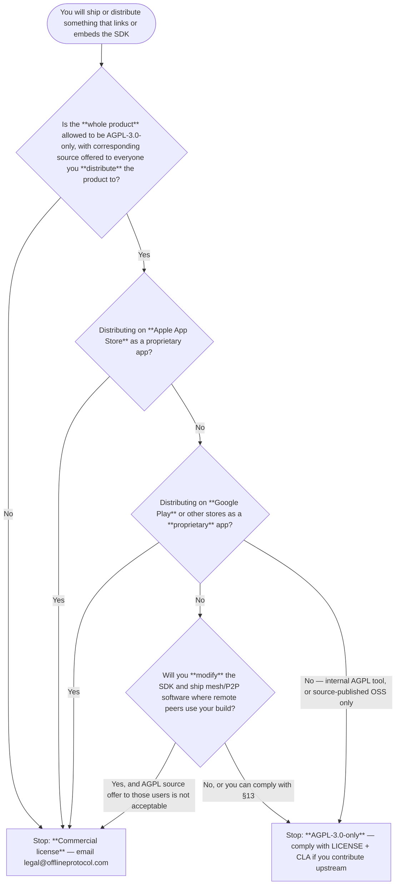

# License decision tree

**Purpose:** Fast legal/product triage before you import the SDK (friction
**#31**). This is **not legal advice**; it routes you to the authoritative
text. Nothing here changes either license.

| Document | Role |
|----------|------|
| [LICENSE](../LICENSE) | AGPL-3.0-only grant |
| [LICENSE-COMMERCIAL.md](../LICENSE-COMMERCIAL.md) | Commercial alternative |
| [Licensing FAQ](licensing-faq.md) | App Store, §13, telemetry, export (read after this tree) |

**SPDX note:** npm/PyPI/crates metadata name **`AGPL-3.0-only` only**. The
commercial license is a separate grant, not a second SPDX id on the package.

---

## Decision flow

Answer in order. The first **stop** that matches your situation is your default
path; read the FAQ section it points to before sign-off.

Plain-language reading of the branches:

1. **AGPL covers your whole app** when you link the SDK ([FAQ](licensing-faq.md#my-app-links-the-sdk-does-the-agpl-cover-my-whole-app)). If you cannot release your application under AGPL-3.0 with source to recipients, do not assume the free license fits.
2. **App Store proprietary apps** — treat as **commercial** ([FAQ](licensing-faq.md#can-i-ship-an-agpl-licensed-app-on-the-apple-app-store)). No §7 app-store exception is granted today.
3. **Play Store proprietary apps** — same as iOS for a closed app ([FAQ](licensing-faq.md#what-about-google-play)).
4. **Modified SDK in mesh** — AGPL **§13** may require source offers to remote users, not only installers ([FAQ](licensing-faq.md#does-the-network-clause-13-matter-for-a-mesh-app)).

---

## Quick picks (common integrator profiles)

| Profile | Usual path | Next read |
|---------|------------|-----------|
| Closed-source iOS/Android app on public stores | Commercial | [LICENSE-COMMERCIAL.md](../LICENSE-COMMERCIAL.md) |
| Closed-source desktop or backend service | Commercial | FAQ: combined work |
| AGPL-3.0 app (source published, recipients get corresponding source) | AGPL | [LICENSE](../LICENSE), [CONTRIBUTING](../CONTRIBUTING.md) |
| OSS app under a license **incompatible** with AGPL for the combined work | Commercial or do not link | FAQ + your counsel |
| Evaluating only (no distribution yet) | Decide before first beta | This tree again before store submit |

---

## After you choose

| Path | Action |
|------|--------|
| **AGPL-3.0-only** | Keep `LICENSE` and notices in redistributions; plan source offers; telemetry optional ([FAQ](licensing-faq.md#is-telemetry-part-of-the-license)) |
| **Commercial** | Contact legal@offlineprotocol.com with product, distribution model, scale ([LICENSE-COMMERCIAL.md](../LICENSE-COMMERCIAL.md)) |

Export control is separate from copyright: [EXPORT.md](../EXPORT.md).
