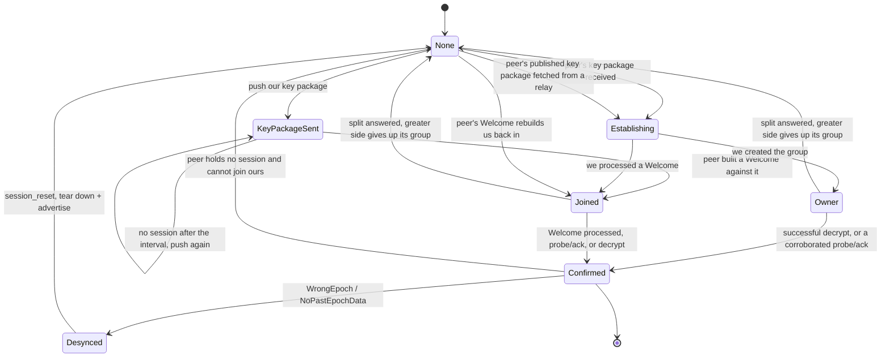

# Session lifecycle (1:1)

A 1:1 session is an MLS group of two, named by the deterministic slot identifier
in [Identity](../spec/identity.md#session-identifiers).

## Invariants

**E1. The slot identifier is symmetric and public.** Both sides compute it
without exchanging it, and so can anyone else.

**E2. An envelope must name the slot shared with its claimed sender.** Checked
before decryption is attempted.

**E3. A desync re-key destroys session state, never queued plaintext.** The
outbound pending queue holds plaintext and is sealed against the rebuilt session
at flush time. This is a property of the re-key, not of every reset: the
post-unblock reset deliberately drops the queue. See
[Session reset semantics](#session-reset-semantics).

**E4. One init key per peer.** An MLS init key is single-use.

## Establishment

### A push that produced no session is pushed again

**A key package we pushed stands in for an exchange only until the resend
interval (30 seconds) lapses.** Past it, no session with the peer means the
push is treated as lost, and the next chance to send repeats it: a discovery
of the peer, or the reconciliation tick while a message waits for that
peer's session.

The failure this prevents is a pair that never forms a session. The push is
one unacknowledged frame, and a carrier can lose it without reporting
anything: two peers that dial each other at once each push over the first
stream, the second stream supersedes it, and the superseded stream's late
frames are dropped with no loss reported, as
[the stream chapter](../spec/stream-framing.md#what-a-receiver-owes)
requires. If both pushes were on it, both sides have recorded the peer as
sent to, and before this rule nothing ever sent again.

Four bounds keep it cheap and correct:

- **The interval is a floor, and it backs off.** Discovery fires on every
  inbound body, so a peer that never answers (an old SDK, encryption opted
  out) would otherwise get a push per frame, or with a fixed floor one every
  30 seconds for as long as it stays in range. Each repeat doubles the wait,
  up to 10 minutes, the same ceiling as the Welcome retries; only a reset
  push or forgetting the peer (a session reset, the neighbour lost) starts
  it over. The floor is stamped before the send, so a send that fails waits
  it out too, but a failed send does not double it: the backoff is for a
  peer that was asked and did not answer, and counting a frame that never
  left would walk an unreachable peer to the cap while it is away.
- **A blocked peer is never pushed to.** A block leaves the queued messages
  that make the tick re-arm a peer, and blocking is bidirectional, so the
  re-arm checks it itself rather than relying on each trigger's caller.
- **A session stops it.** A session that exists but is unconfirmed belongs to
  the Welcome lifecycle and the confirmation probes, which own that half.
- **It is the same package.** The pool hands a peer its own live package
  until a Welcome consumes it (see [Key package pool](#key-package-pool)), so
  a repeat push mints no key material and leaves E4 intact.

Only a peer already pushed to qualifies. The first push stays discovery's,
and a first push that failed to send is still not recorded, so the next
discovery makes it. The one exception is a peer only the mesh reaches, which
discovery never names: the tick makes its first push (see
[A peer only the mesh reaches is pushed to from the tick](#a-peer-only-the-mesh-reaches-is-pushed-to-from-the-tick)).

**A lost reset push is healed by the repeat, which says we hold no
session.** The repeat never carries `session_reset`: when the lost push was a
reset, a repeat of the flag that overtook the replacement session's Welcome
would tear the replacement down too. It carries `no_session` instead, and the
peer, holding a session we cannot read, tells the two cases apart by the
package: if the Welcome it built names this package, the Welcome never
arrived and is sent again; otherwise it drops its session and builds a new
one from the package. See [A peer that holds no session](#a-peer-that-holds-no-session).

### A peer only the mesh reaches is pushed to from the tick

**A message waiting for a session is enough to start that session over any
path that can carry a frame to the peer.** The first push is otherwise
discovery's, and discovery names only the device a frame arrived from. A peer
two hops away is never discovered: every frame from it arrives attributed to
the device in between. Before this rule a message to a device the sender had
never been next to waited in the pending queue for its full lifetime, because
the key package and the Welcome were the only two frames that never crossed
the mesh, and every frame after them is sealed.

So the reconciliation tick, for each peer holding a queued message that has
never been pushed to, pushes the key package when no carrier can address the
peer directly, no infrastructure carrier claims to reach it, at least one mesh
neighbour exists, and no session exists. The package is handed to neighbours
whenever no carrier is known to reach the peer, whatever the direct send
returned: the internet carrier accepts a frame for a peer the relay has already
said it cannot reach, and an offer made only on a failed send never fired on an
online device. A neighbour taking it counts as sending it, so the peer is
recorded and the re-push ladder above takes over from there; a push no
neighbour took is tried on the next tick.

The recipient's side has three rules of its own:

- **The Welcome is handed to neighbours when no carrier is known to reach the
  peer**, by the same rule as the package, and takes the same in-flight path as
  a Welcome a carrier accepted, with the mesh confirmation timeout. A carrier's
  `Ok` was never proof of arrival; the peer's probe or decrypt still settles it.
- **A package from a peer only the mesh reaches re-arms a stalled Welcome.**
  The peer re-pushes only while it holds no session, so its package says our
  Welcome never arrived. A neighbour's Welcome is re-armed on rediscovery and a
  relay peer's on presence, but a peer two hops away produces neither: without
  this a Welcome that expired while the path was down was never sent again, and
  the message waiting on it sat out its lifetime. Only a `Created`, `Failed` or
  `Expired` lifecycle is re-armed; one in flight or confirmed is left alone.
- **A package from a sender only the mesh reaches is not answered with ours
  first.** The Welcome is all the sender needs to join. Answering with a
  package would make both sides build a group for the tiebreak to discard,
  every frame of both crossing each device in between. The fresh package a
  new session sends for group invites still goes, after the Welcome.

### A peer only a relay reaches is asked about

**A session wanted with a peer this device holds no key package for is
enough to ask every carrier that can produce one.** For a peer known only by
address and reachable only through a Nostr relay, that carrier is the relay:
the peer published single-use key packages there ([the Nostr
guide](../nostr.md#published-key-packages-and-cold-first-contact)), and
fetching one is the whole of cold first contact.

Nothing asked before this rule (issue #633). A send with no session only
queues, so no frame is built for the transport to attach a lookup to;
discovery's first push never names a peer that has sent nothing; and the
mesh push above stands down whenever Nostr claims to reach the peer. The
records were published and never fetched.

So three places ask the relays, each only where it has found no key package:
a send, an explicit `establish_secure_session`, and the reconciliation tick
for each peer holding a queued message that has never been pushed to. The
tick is what repeats it: a lookup no relay could answer (none held a record
yet, or none was live) is otherwise never asked again while the message
waits. The transport allows one lookup per peer every 5 minutes, and that
check runs before the session check so that a waiting peer costs one
storage read per interval rather than one per tick.

No lookup is made for a blocked peer, with cold contact off, for a peer that
already has a session, or for a peer on a live mesh link: the link carries
the exchange within a tick, and a lookup would only tell the relays which
address this device wants. A fetched package is handled as a pushed one is,
so the session is built on arrival and our own package goes back, which is
what heals a fetched package that was already consumed.

### An unconfirmed session holds one probe

An unconfirmed session is probed on a fixed cadence, and **a peer holds at most
one probe in the outbox**: each new probe supersedes the last rather than
stacking its own retry ladder on top. The cadence only backs off on a relay
verdict (`unreachable` or `relay_pushed`), which a mesh-only carrier never
produces, so stacked probes once filled the outbox and capacity eviction failed
real messages.

The supersede lives in the one function that sends a probe, because two paths
call it: the periodic scan and the fast path taken when the transport confirms
a Welcome went out. A supersede in the scan alone left the fast path's probe
with its full ladder. The same function sets the next due time, so the scan
does not supersede a fast-path probe before its acknowledgement can arrive.

Superseding is not a delivery failure and is not counted against the carrier.
It does not discard the relay's answer either: a verdict finds its peer through
the outbox entry, so the superseded id is remembered, and a verdict slower than
one probe interval (but faster than two) still backs the cadence off. Dropping
it left a peer the relay had refused probed every five seconds, which is the
rate that flaps the relay connection. Only the last superseded id is kept: a
verdict that misses two intervals finds neither, and the cadence backs off on
the next probe's verdict instead. Relay verdicts arrive well inside one.

A probe is not persisted, and one an older build persisted is dropped at
restore: the new process does not know which probe was the last, so a restored
one could never be superseded, and the next scan asks the same question. For
the same reason a probe is withdrawn with the rest of the confirmation tracking
when the session confirms or is torn down: a probe the tracking no longer names
could never be superseded, and would keep its ladder.

### Both-create convergence

Both peers can create a session simultaneously. The tiebreaker orders the two
addresses by **hash bytes** (see [Identity](../spec/identity.md#ordering)) and
one side adopts the other's Welcome.

The **owner** side, whose session survives, never *adopts* a Welcome. It may
well receive the peer's Welcome, but the tiebreaker keeps the local session and
the Welcome is not processed into one, so any mechanism that keys off Welcome
adoption silently skips the owner. This is why:

- session confirmation also triggers on **any successful decrypt** in the 1:1
  group (a decrypt in a multi-party group the pair shares says nothing about
  their 1:1 session, and confirming on one let a split confirm), and
- the pending-decryption drain hangs off that confirmation, so a decrypt reaches
  it too.

"Also" is the operative word. Confirmation is not decrypt-only: the joiner
confirms while processing the Welcome itself, and a plaintext confirmation probe
or its acknowledgement confirms too. Successful decrypt is the trigger added on
top so that the one side no other trigger can reach, the both-create owner, is
still covered. Only that owner, waiting on the adopt path, depends on decrypt
alone.

The drain is downstream of the confirmation **transition**, not of decryption as
such: a decrypt on a session that is already confirmed does not re-run it.

**The owner sends a fresh key package for every session Welcome it does not
adopt.** That Welcome was built on a package of the owner's, which the adopter
spent on the group it gives up, so the adopter holds none of the owner's for a
later group invite. The adopter sends one after adopting, as every side that
joins does; the owner sends one whether it is still waiting for the adopter's
proof or has already confirmed, since the adopter's proof can overtake its own
rival Welcome. Without it a pair whose packages crossed left the adopter's
invites failing with no key package for as long as the session lived. Packages
cross most often through a device in between, which forwards each frame after
its own jitter, and there the owner's reciprocation on the adopter's packages is
gated on reaching it directly, so nothing else sent one. The pool hands the
adopter its live package again, so the push repeated on a retransmitted Welcome
mints no key material.

Anything else that has to happen exactly once when a session becomes usable
hangs off that same transition rather than off the four call sites that reach
it. Document replication's version exchange is the current example. Wiring such
a thing per call site is how a feature ends up silently absent on whichever
confirmation path somebody forgot, and the session-lifecycle event is not a
substitute: it does not fire on the probe or acknowledgement paths.

An encrypted confirmation frame travels inside the envelope on the adopt path
precisely so the owner gets a group-aware decrypt to converge on. It is consumed
on receipt and never surfaced to the application.

## Key package pool

An MLS init key is consumed when a Welcome built against it is processed. Two
peers handed the **same** key package therefore cannot both establish: the
second Welcome is unprocessable.

The pool assigns **one package per peer**. Resolution order for a push:

1. This peer's own live package, so repeat pushes cost no key material.
2. An unclaimed package, claimed here. Claiming is what stops an upgrade
   stranding a pre-existing package.
3. A fresh mint.

The assignment is stored **on the bundle**, not in a side map, so it survives
restarts and cannot disagree with the pool.

Rotation is consumption-driven: a consumed package is reported gone and the next
push mints a successor, which is RFC 9420's guidance to rotate as soon as
possible after use.

### The ceiling

The pool is bounded (64 live packages). **At the ceiling it shares the newest
package rather than refusing to advertise or evicting**, because either
alternative costs session establishment outright, and it reports pool exhaustion
as a suppressed warning.

The ceiling gates **only the mint**, which is the only step that grows the pool.
A claim relabels a package that already exists, so steps 1 and 2 run ahead of the
check and a full pool holding an unclaimed package still hands out its own key.
Gating the claim too would weaken forward secrecy to stay under a bound the claim
never approaches.

Reaching the shared branch therefore proves every live package belongs to another
peer. "Newest" makes it the one most likely to be mid-establishment: if the
over-ceiling peer's Welcome lands first, that peer's advertisement goes
unprocessable until its next push.

### Expiry destroys key material in two stages

Deleting the bundle record alone leaves the private init key in the MLS provider
**forever**, because only a peer's Welcome removes one.

1. Expiry **withdraws** the package from every caller immediately.
2. Only past a grace window (7 days) is the provider key destroyed. The provider
   key is deleted **first**, and the record is kept so a failed deletion can be
   retried.

The grace window exists so a Welcome built just before expiry still opens.

Deletion also purges legacy records whose format predates the bundle: an
unparseable record is read as the serialized key package so its provider
reference is derivable. A record-only delete there is the exact stranding this
rule removes.

### A package the application publishes stays under expiry

An application that uploads a package to its own key server marks it with
`mls_mark_key_package_synced`. The mark keeps the record and flags it, so the
two stages above still own it: withdrawn at expiry, destroyed past the grace
window, whether or not anybody used the uploaded copy. A synced package is
withheld from the push path and from the peer-less getter, as a slot package
is, because a stranger may already hold it. Deleting the record on the mark,
which is what it once did, stranded the init key with nothing left to expire it
([ADR 0012](../adr/0012-one-key-package-per-peer.md#a-package-the-application-publishes-keeps-its-record)).

The pending list an application uploads from holds only packages nobody has
spoken for: never a peer's, never a slot's, never one already synced.

## Desync and heal

An **established** session whose two sides disagree on the MLS epoch yields an
epoch-disagreement decrypt failure. This is a dedicated recoverable class, kept
strictly separate from ordinary decryption failure. See
[Delivery and acknowledgements](delivery-and-acks.md#classifying-decrypt-failures).

**A receiver that has fallen past its forward window is in the same class.**
A frame more than the sender-ratchet forward distance (8192 generations) ahead
of what the receiver last decrypted can never decrypt, and neither can any
later frame from that sender, including every re-sealed resend, because each is
further ahead still. Classified as an ordinary failure, that waited forever for
a resend that could not succeed: the 2026-10-19 volume test lost a whole
direction this way, as thousands of per-frame `INVALID_CIPHERTEXT` failures
with nothing ever healing them. It is classified as a desync and heals the same
way. A frame too far *behind* (past the out-of-order tolerance) stays an
ordinary failure: the session is healthy, and the sender's re-sealed resend
recovers it.

Unlike the epoch checks, this trigger is authenticated. MLS decrypts the
sender data under AEAD before it reads the generation, so only a holder of the
epoch's sender-data secret can produce it. It widens nothing in the
unauthenticated surface described below.

### Tier 1: honest failure and heal (receiver side)

On a desync the receiver:

1. **Withholds** the delivery acknowledgement and unmarks the identifier. A
   frame that came over the relay is answered `undecryptable` instead, which
   is never read as a delivery.
2. Does **not** enqueue. The ciphertext is sealed to a dead epoch and can never
   drain.
3. Schedules a re-key.

The re-key tears down **our own** stale session and advertises a key package
flagged as a session reset. The peer drops its stale session, rebuilds from our
key package, and Welcomes us back, which we join session-less.

**Deleting the local session is what makes convergence symmetric for both
address orderings.** The returning Welcome is *joined* rather than gated by the
greater-address-adopts tiebreaker.

### The rate-limit floor is never reset early

One re-key per peer per interval (30 seconds), stamped before the send.

A successful decrypt on the healed session does **not** clear the floor. A
genuine re-fork and a replayed old-epoch frame are indistinguishable at this
layer, so clearing on heal would let an attacker interleaving one legitimate
decrypt between replays force roughly one teardown per inbound message.

The floor lapses only by the interval elapsing. Tier 1's withheld
acknowledgement plus sender retries keep delivery honest during the wait.

### The same path, driven deliberately

An application may drive a re-key itself, through `rekey_session`. What reaches
the peer is what a desync-driven one sends, because the teardown and the reset
advertisement are one shared step, so a peer cannot tell the two apart.

Two differences on this side. The rate-limit floor above is shared, so a caller
looping on it cannot do to a pair what that bound exists to stop an attacker
doing; a call inside the window reports that it did nothing rather than
failing. And the `SessionRekeyTriggered` security warning is **not** emitted,
because it names an epoch desync and exists so that a sustained rate of them
reads as an attack signature. A scheduled rotation firing it would put an
operator's own maintenance in front of them wearing that shape.

**The reset is advertised before the session is discarded, and a rotation that
cannot be sent discards nothing.** A transport reports an error only once
nothing has accepted the frame, so a failure means the peer was told nothing,
and the session an application asked to rotate is healthy: it is kept, and the
window is not spent. The desync path makes the opposite choice on the same
failure, because what reaches it is a fork rather than a healthy session, and a
fork decrypts nothing whether or not the peer could be told. The order is
invisible to a peer either way, since both steps run before any inbound frame
can be processed.

**This is the only way post-compromise security arrives on a pair that never
desyncs**, and it is the only way at all on a pair containing a leaf node,
which never commits. The interval is the application's to choose; nothing in
the engine schedules one. See
[Leaf node provisioning](../spec/leaf-provisioning.md#post-compromise-security-is-the-phones-to-originate).

### Tier 2: true no-loss (sender side)

The sender re-seals each resend against the peer's current session. See
[Outbox and retries](outbox-and-retries.md#retry-re-sealing).

Tier 1 alone makes the fork **detectable and healable**. Tier 2 is what makes it
**lossless**.

### The trigger is unauthenticated and cannot be made otherwise

This is residual risk R2 in the
[threat model](../security/threat-model.md#r2-unauthenticated-session-desync-trigger),
and it is repeated here because it constrains any change to this state machine.

The peer identifier passed to the re-key scheduler is the **wire-claimed**
sender. The encrypted prefix is data-plane and deliberately exempt from the
signature gate; MLS validates the framing header (group identifier, then epoch)
**before** any AEAD, sender-data, or signature check; and a slot identifier is a
public function of two public addresses.

So anyone who can inject a frame reaches this classification, with no key
material, no captured ciphertext, no session, and no replay.

This is inherent to MLS framing, not an implementation defect. A sender-identity
check structurally cannot help: the MLS credential it would compare against
exists only once decryption **succeeds**.

**The mitigation is that acting on the trigger is harmless, not that it is
trusted:**

| Property | Effect |
|----------|--------|
| Slot binding (E2) | One derivable identifier cannot be aimed at arbitrary peers, and the re-key tracking map cannot be grown with attacker-chosen keys |
| Bounded tracking map | Memory is bounded regardless |
| Per-peer rate limit | Churn is bounded |
| The re-key preserves the pending queue (E3) | Nothing is destroyed |
| Sender-side re-sealing | Resends deliver after the heal, for entries whose re-seal provenance survives in memory |
| A security warning per re-key | A sustained rate, meaning injection rather than a real fork, is visible |

**Residual:** bounded re-key churn on a pair. Delivery delayed, never silently
lost. A fork that spans a sender restart is the one case where the resend cannot
recover, because the re-seal provenance did not survive
([outbox S3](outbox-and-retries.md#invariants)); those messages settle as an
honest failure rather than a false delivery.

**What would close it:** a signed epoch-corroboration exchange before teardown. A
liveness-only probe does not work, because a healthy peer answers and the
teardown happens anyway.

## Split sessions

**A confirmation stands only on proof that both sides hold the same group.**
Two sides can hold two different groups for one slot, and nothing above sees
it: a 1:1 session never commits after it is created, so the two groups sit at
the same epoch, frames between them pass MLS framing validation, and each
fails as an ordinary decryption failure. ADR 0006 keeps the re-key off that
class, rightly, because a corrupted frame reaches it.

The common way in is a both-create race that loses the owner's Welcome. The
owner keeps its group, as the tiebreak says. The adopter never received the
Welcome it was meant to adopt, so it still holds its own, and before this rule
the owner's plaintext probe confirmed it. The adopter then flushed its queue
under a group the owner never joined.

So a probe and its acknowledgement carry a corroboration: the sender's epoch
and an MLS exporter tag over a nonce (a probe's challenge, or the nonce of the
probe an acknowledgement answers), which only a member of the same group at
the same epoch computes (see
[the spec](../spec/control-messages.md#session-corroboration)).

| What the frame shows | What the receiver does |
|----------------------|------------------------|
| Same epoch, same tag | Confirms, as group-aware proof. The both-create owner included |
| Same epoch, different tag, on an acknowledgement answering our live challenge | Does not confirm. The split: the side whose address is greater gives up its group |
| Same epoch, different tag, on anything else | Does not confirm, tears nothing down. The greater side issues a challenge of its own |
| Different epoch, or nothing this side can compare | Does not confirm, and does nothing. The epoch-desync path owns an epoch mismatch |
| Empty body | An older peer or a leaf: the plaintext rules above |

**Only the greater side heals**, the side that adopts in the tiebreak. If both
did, both would tear down at once, each would rebuild from the other's
package, and the pair would race again.

**And only on an answer to its own live challenge.** A probe's nonce is a
challenge, remembered with the session it was issued under and repeated by
every probe until it is answered (probes run every few seconds, and an answer
over the mesh can take longer), and an acknowledgement answers with the
responder's tag over that same nonce. Any
other mismatching frame may be stale: a probe sealed under a group that has
since been healed and delivered late, an outbox retry carrying an earlier
group's tag, or a recording. Acting on those tore healthy sessions down, so
they only make the greater side issue a challenge of its own. Whichever side
probes first, the greater side learns within one round trip, and a challenge
is spent by its first answer.

**The heal gives up the greater side's group, not the pair's.** It sends a key
package saying it holds no session, then drops its group, and the peer answers
as for any `no_session` package (below). After a both-create race the peer's
Welcome names that very package, because it was never consumed, so the peer
resends it and keeps its group, and the greater side joins. A Welcome that was
only delayed is joined the same way. A reset there made the peer rebuild on
the same package, and the delayed Welcome then split the pair again. The heal
shares the re-key floor; a push that could not be sent drops nothing and gives
the floor back, because the peer was told nothing and the next challenge asks
again. An answer that meets the floor held (a heal or re-key within the last
30 seconds) has spent its challenge, so the greater side asks again once the
floor opens, from the reconciliation tick; asking at once would do nothing,
since the ask that drew the answer has just set its own limit.

### A peer that holds no session

**A pair where one side holds a session and the other none is rebuilt, never
left.** The side without one cannot read anything the other seals, and the
other never re-enters the desync path, because the first sends nothing sealed.
A lost reset is the usual way in, and a store that lost the session another.

Every key package sent while this side holds no session with the peer carries
`no_session`. A peer holding a session answers it under the same freshness and
spent-reset rules as a reset, since it can end in the same teardown:

| The peer's retained Welcome | What the peer does |
|-----------------------------|--------------------|
| Names this key package | Sends it again and keeps its session. The package is consumed by the Welcome built on it, so a sender still offering it never processed it. A send in flight is settled as lost first, the one legal way back to a send |
| Names another package, or there is none | Drops its session as for a reset, and builds a new one from the package |

The comparison is what makes the flag safe where repeating the reset flag is
not: a replacement whose Welcome is in flight is recognised and kept. Two
rules keep the comparison honest:

- **A flag older than the session is refused.** The spent mark moves up to the
  signed stamp of the frame the session was built from (the key package it was
  created from, or the Welcome it was joined from), so a `no_session` (or
  reset) frame older than that is refused: a first-contact push delivered late,
  or a recording. Only those frames, and never more than five minutes past this
  device's own clock, since the mark is durable and a peer clock that ran fast
  and was set back would otherwise lock that peer's resets out. Five minutes
  rather than none, so ordinary skew between the two clocks does not put the
  mark below the session's own stamp. The teardown also needs the frame's stamp
  to be signed at all; resending a Welcome needs neither. A teardown that is
  acted on records the frame's own stamp, unclamped, as a reset always has, so
  a peer whose clock ran fast when it lost its session is refused until its
  clock catches up.
- **A push that crossed the Welcome is refused at any skew.** Every push from
  a side holding no session carries the flag, first contact included, so the
  peer's first-contact key package can arrive just behind the Welcome it sent
  after it. For ten minutes after the session is built, a `no_session` frame
  not newer than the unclamped stamp of the frame that built it is refused.
  Both are the peer's own clock, so the five-minute clamp on the spent mark
  does not decide this case.
- **An adopted Welcome retires our own.** Adopting the peer's Welcome in the
  both-create tiebreak gives up our group, and our outbound Welcome for it is
  dropped. It names a package the peer never processed and still offers, so
  kept, it would answer a `no_session` with a Welcome for a group nobody
  holds.

The flag states the sender's view when the frame left. One that arrives after
its sender gained a session, because a frame crossed it in flight or the
carrier reordered them, costs one extra rebuild, bounded like any reset by the
spent-reset mark.

### A failed frame asks

**A split between two sides that have both confirmed is found by the first
frame that fails between them.** Confirmation probes stop once a session
confirms, so a split that formed some other way, through an older peer's
plaintext confirmation or a restored store, would otherwise fail every frame
for the life of the pair.

So an ordinary decrypt failure on a 1:1 session, of a message or of a media
chunk, sends a confirmation probe, at most once per peer per re-key interval.
It only asks. A healthy session answers with a matching tag and nothing
happens; a split answers with a different one and is healed as above. Nothing
is torn down on the failure itself, which is what ADR 0006 requires of a class
that anyone corrupting a frame can reach.

## Session reset semantics

Two paths advertise a key package with the reset flag set, and they differ in
exactly one respect that matters: what happens to queued outbound plaintext.

**The desync re-key**, described above, is a repair. It:

- deletes local session state,
- **keeps** the outbound pending queue, which holds plaintext and is sealed
  against the rebuilt session at flush,
- advertises a fresh key package with the reset flag set.

**The post-unblock reset** is a clean slate, not a repair. When one side unblocks
the other, it deletes its session and advertises a reset so both sides converge
on a single fresh group rather than one orphaned session each. It additionally
**drops** the peer's pending queue, failing each queued message terminally, and
discards the held key package and learned capabilities.

The difference is deliberate. A re-key repairs a session the user still wants,
so destroying their unsent messages would be the bug. A block severed the
relationship, and delivering messages queued before the block, on the strength of
an unblock, is not what the user asked for. A reader reasoning about queued
plaintext must therefore ask which reset they are looking at.
